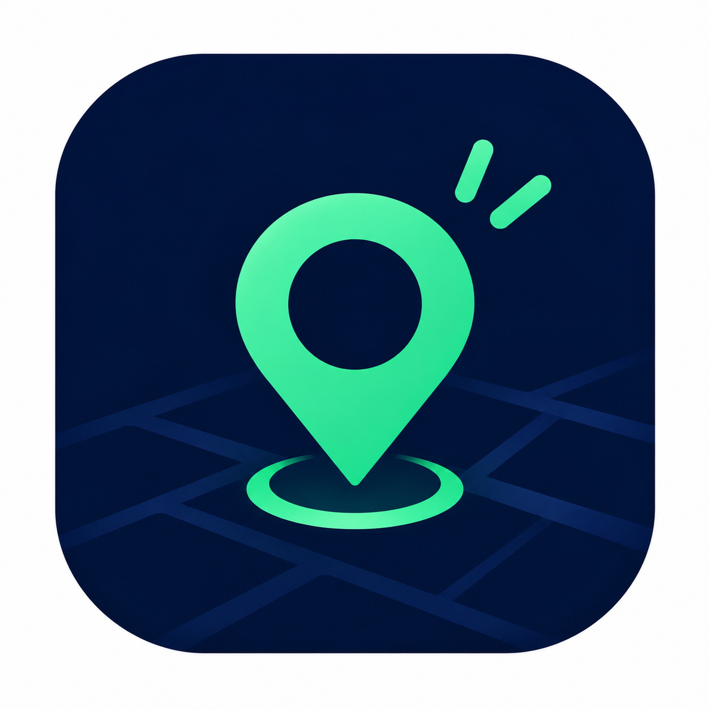

# knightone# DropRadar

A quiet package tracking and geofence proximity web app built to reduce unwanted delivery calls while keeping handovers clear, private, and accessible.

## Key Features
- **Geofence Proximity & Map Views**: Set saved home and drop zones, adjust perimeter radii (`250m`–`2km`), simulate or step closer rider proximity, and switch across Radar Grid, Street View, and Satellite views with an offline-safe canvas fallback and optional Google Maps integration.
- **College Zone & Backup Call Routing**: Configure a college/campus zone and route calls to a privacy-masked backup contact (`Relay #DR-804`) when in class or away from your room.
- **Driver Drop Pin & Quiet Delivery Notes**: Share coordinates, Google Maps / OpenStreetMap links, and no-call or gate/drop-off instructions in a single copyable note.
- **Order Lookup & Customer Profile**: Search and log orders by customer order number across quick-commerce, food, and courier apps, and manage your profile, alternate number, and past orders in the corner drawer.
- **Accessible Controls**: High-contrast dark UI with `48px+` touch targets and an `Aa+ Large Text` toggle.

## How to Run Locally
1. Download or clone `index.html`.
2. Open `index.html` directly in any modern web browser (no build step or external dependencies required).

## Host with GitHub Pages
1. Upload `index.html` (and `README.md`) to a GitHub repository.
2. Go to **Settings > Pages**.
3. Under **Branch**, select `main` (or `master`) and `/ (root)`, then click **Save**.
4. Once published, open your GitHub Pages URL (`https://<your-username>.github.io/<repo-name>/`).

## Notes & Limitations
- This project runs as a client-side web app with simulated/local tracking state and browser `localStorage` persistence.
- Real-world live GPS feeds from third-party delivery apps, automated OTP entry, and carrier-level telecom call forwarding are not performed directly inside the static browser app.

